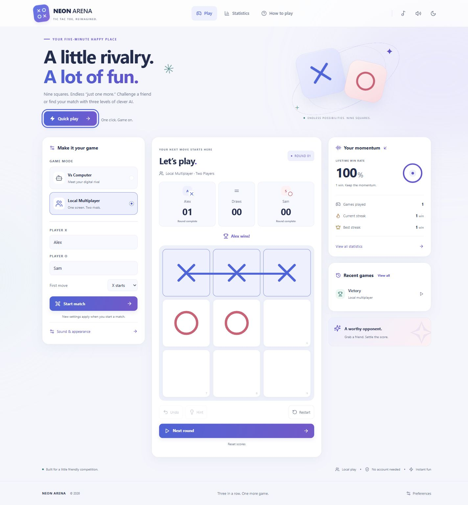

# Tic Tac Toe - Neon Arena

A colorful, browser-local Tic Tac Toe application by **Priyam Patil**, with intelligent AI, local multiplayer, polished light/dark themes, original synthesized audio, and persistent statistics.

[GitHub repository](https://github.com/Priyam-Patil/Tic-Tac-Toe-Neon-Arena) | [Running guide](RUNNING_GUIDE.md) | [Project documentation](docs/PROJECT_DOCUMENTATION.md) | [Verification](VERIFICATION.md)

**Release status:** verified locally; GitHub push and Vercel deployment are awaiting owner approval. A live URL will be added only after deployment succeeds.



## Features

- Local two-player matches with custom names and X/O first-player selection.
- Computer opponents: random Easy, tactical Medium, and optimal Minimax/Negamax Hard.
- Human choice of X or O, automatic AI openings, and a thinking indicator.
- Correct wins/draws, illegal-move guards, winning-cell highlights, an animated line, and a result dialog.
- Match scores; lifetime wins/losses/draws; current/best streaks; the latest 100 completed game replays.
- Undo, optimal hints, restart, rematch, separate score/statistics resets, and confirmation dialogs.
- Light/dark themes, gesture-gated sound effects, independent original ambient music, and saved animation settings.
- Responsive layouts, keyboard navigation, native dialogs, visible focus, and reduced-motion support.

No online multiplayer, leaderboard, paid API, account, backend, or fabricated demo statistics are included.

## Technology

React 19, TypeScript 5.9, Vite 7, Tailwind CSS 4 with custom CSS, Motion 12, Lucide React, Web Audio API, and versioned LocalStorage. Tests use Vitest, Testing Library, jest-dom, and jsdom. Node built-ins provide security/HTTP checks. ReportLab and Poppler are used only for project documentation.

## Installation

Use Node.js 22.12+ or a newer compatible LTS, npm, and optionally VS Code.

After publication:

```sh
git clone https://github.com/Priyam-Patil/Tic-Tac-Toe-Neon-Arena.git
cd Tic-Tac-Toe-Neon-Arena
npm ci
npm run dev
```

For the already-local project, open the directory containing package.json in VS Code and run the last two commands there. Open the Local URL printed by Vite, normally http://127.0.0.1:5173/. If a synced folder prevents Node/Git writes, use a normal writable local copy. In PowerShell, use npm.cmd if npm.ps1 is blocked; changing system execution policy is unnecessary.

## How to play

1. Select **Local Multiplayer** or **Vs Computer**.
2. Configure names, difficulty/mark where applicable, and the starting mark.
3. Click **Start match**, then choose empty cells. The AI responds automatically.
4. Connect three marks in a row, column, or diagonal. A full board without a winner is a draw.

**Quick play** starts a medium AI game as X immediately. Setup changes apply only to a new match. **Home** retains the board; **Play** returns to the focused arena.

Undo removes one local move or a complete human/AI turn while the round is unfinished. Hint highlights an optimal move. Restart clears the board while retaining match scores. Reset scores and Reset lifetime statistics have separate, clearly explained effects.

Lifetime results follow the human mark against AI or **Player X in local play**. Match score cards track X, O, and draws. Data stays in the current browser/origin and does not sync between devices.

## Keyboard and appearance

Tab to the board, use arrows to navigate, Enter/Space to play, and 1-9 to select a square. Home/End focus the first/last cell; Escape closes dialogs. Header buttons control theme, sound, and music. **Sound & appearance** / **Preferences** also provides the Animations switch. OS reduced-motion requests take precedence.

## Tests and production build

```sh
npm test
npm run test:watch
npm run security:check
npm run build
npm run preview -- --port 4173 --strictPort
```

The production build runs strict TypeScript checks, including unused-local/parameter checks, and writes dist. Preview normally runs at http://127.0.0.1:4173/.

With production preview running, verify the document, assets, MIME types, and security headers:

```sh
node scripts/check-production.mjs
```

There is no standalone ESLint/lint script. **Fresh verification: 59 tests pass; production build passes; npm audit reports 0 vulnerabilities.** Tests include all winning lines, draws, turn/illegal-move guards, scoring/streaks, undo/race guards, persistence/legacy saves, controls, replay, and audio. Hard AI is exhaustively checked against all human response sequences for both marks/starters. See VERIFICATION.md for exact scope and limitations.

## Structure

```text
src/main.tsx              React entry
src/App.tsx               Views, setup, controls, dialogs, and effects
src/styles.css            Themes, responsive layout, focus, CSS animation
src/components/           Marks, modal, scoreboard, winning line, replay, motion context
src/game/logic.ts         Rules, board helpers, all AI algorithms, undo calculations
src/game/store.ts         Reducer, turn selection, scores, history, validated persistence
src/hooks/useAudio.ts     Original Web Audio effects and music
src/**/*.test.*           Five automated test files
scripts/                  Credential scan, production HTTP check, PDF generator
docs/                     Documentation source, PDF, and actual screenshots
```

Navigation uses local React state, not a routing library or nested URL paths.

## Screenshots

The images are captured from the actual production build after real verification games.

- [Light arena](docs/screenshots/light-desktop.jpg)
- [Dark arena](docs/screenshots/dark-desktop.jpg)
- [Result dialog](docs/screenshots/result.jpg)

To capture your own: run the app, select a theme, play a round, and use browser screenshots. Test narrow widths such as 320/390px, a 768px tablet, and a 1440px desktop. Avoid inventing scores to make images look populated.

## Security

.gitignore excludes dependencies/builds, private environment files, service-local authentication state, credentials, private key formats, logs, caches, editor files, and generated output. No .env file or API credential is needed. The scanner prints locations/categories only and checks publishable contents plus reachable local history; pattern scanning cannot detect every possible secret.

vercel.json configures a same-origin Content Security Policy, nosniff, frame denial, a referrer policy, and restricted device permissions. Inline styles are allowed for UI animation; inline scripts/eval are not enabled. Production preview applies the same headers. LocalStorage is user-editable device storage, not encrypted or an anti-cheat service.

## Vercel deployment

After owner approval, push to the **existing** repository and import it into Vercel (or reuse its matching project):

- Framework: **Vite**
- Root: repository root containing package.json
- Install: **npm ci**
- Build: **npm run build**
- Output: **dist**
- Environment variables: **none**

vercel.json contains the build/output/header settings. No deep-route rewrite is needed. Verify deployment state, the actual live URL, assets, and gameplay before recording success. See [Vercel's Vite guide](https://vercel.com/docs/frameworks/frontend/vite).

## PDF documentation

The complete Markdown source is docs/PROJECT_DOCUMENTATION.md. The prepared PDF is docs/Tic-Tac-Toe-Neon-Arena-Documentation.pdf. Its live-link status remains pending until a verified deployment exists.

To regenerate using Python with ReportLab installed:

```sh
python scripts/build-documentation.py
```

The generator writes output/pdf/Tic-Tac-Toe-Neon-Arena-Documentation.pdf. Render with Poppler for visual review before publishing an updated PDF.
