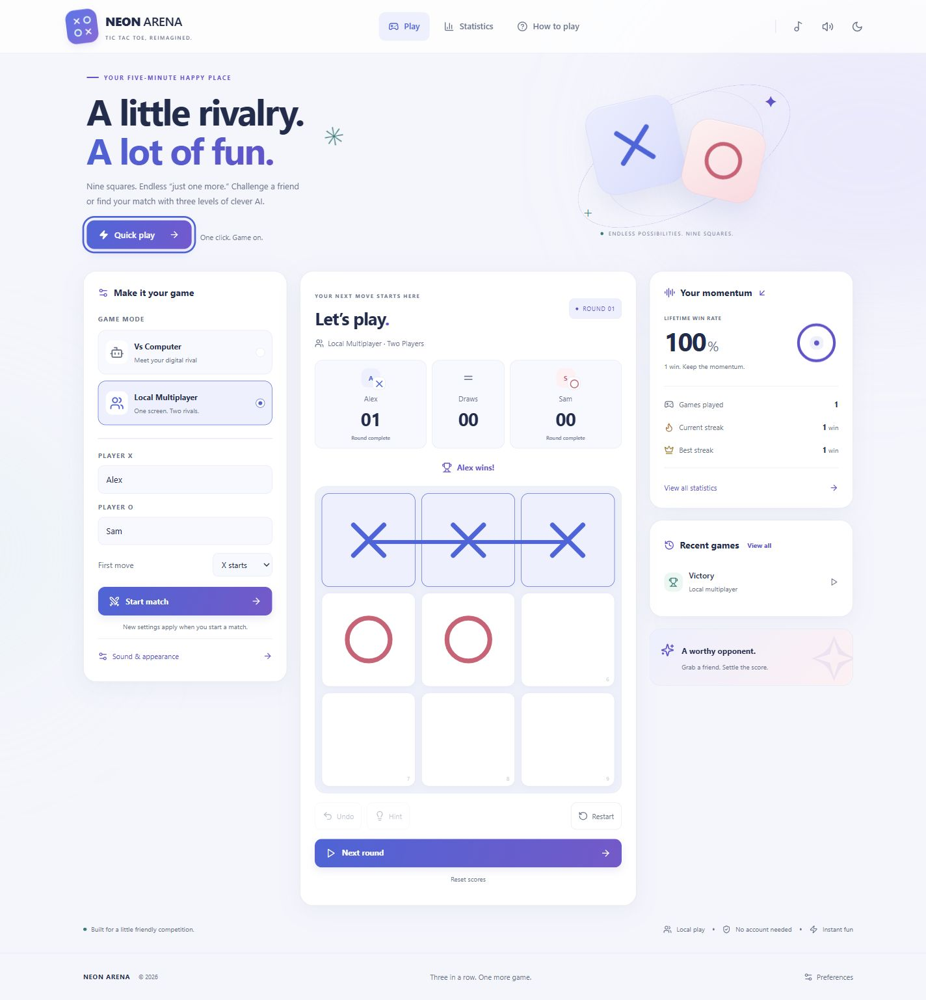
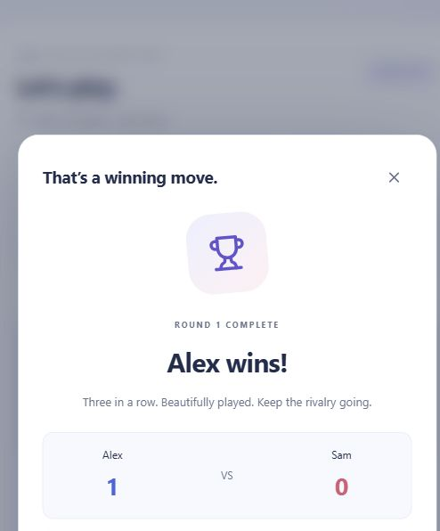
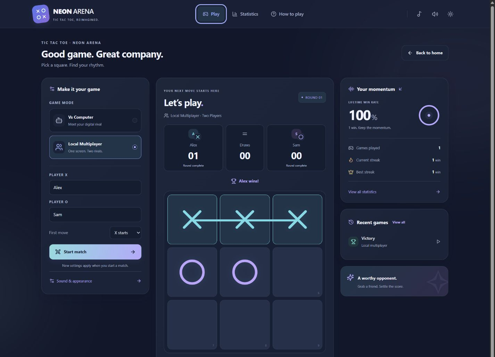

# Tic Tac Toe - Neon Arena

## 1. Project overview

**Project type:** React Web Application. **Author:** Priyam Patil. **Repository:** [Tic-Tac-Toe-Neon-Arena](https://github.com/Priyam-Patil/Tic-Tac-Toe-Neon-Arena).

Neon Arena is a browser-local implementation of the classic three-by-three Tic Tac Toe game. It combines correct rules with a colorful light/dark interface, a computer opponent, local two-player play, and persistent match statistics. It is a static frontend application: no server, account, database, paid API, or network game service is required for play.

The objective is to make a short game feel complete and approachable. A player can begin immediately with Quick Play, customize a match, use hints or undo while learning, and review finished games through replay. The intended users are casual players, two friends sharing a device, beginners learning strategy, and developers studying a small typed React application.

### Implemented features

- Local multiplayer with two custom names and a selectable starting mark.
- Computer play with Easy, Medium, and Hard difficulty and a human choice of X or O.
- Correct wins, draws, legal-move guards, turn indicators, scores, and game-over dialogs.
- Restart, next round, reset scores, confirmation dialogs, undo, and optimal hints.
- Light/dark themes, synthesized sound effects, original ambient music, and a saved animation preference.
- Winning-cell highlights, an animated winning line, symbol drawing, thinking dots, confetti, and draw feedback.
- Lifetime wins/losses/draws, current/best streaks, the latest 100 history records, and replay with pause/resume and scrubbing.
- Responsive layouts, visible focus states, keyboard controls, native dialogs, and reduced-motion support.

Online multiplayer, leaderboards, achievements, daily challenges, a service worker, and cloud synchronization are not implemented or presented as working features.

### Release status

Local checks and the production build are complete. GitHub publication and Vercel deployment are awaiting explicit owner approval. The repository already exists and was empty when inspected. No live website URL is available yet. The PDF and release documentation will be updated after a deployment has actually succeeded and been verified.

## 2. Technology stack

| Technology | Actual role in this project |
| --- | --- |
| React 19 | Components, state, effects, reusable interface elements, and event handlers. |
| TypeScript 5.9 | Typed marks, boards, preferences, sessions, results, reducer actions, and strict compilation. |
| Vite 7 | Local development, optimized static production build, and production preview. |
| Tailwind CSS 4 | CSS integration through the Vite plugin and theme/import processing. The design also uses substantial custom CSS. |
| Motion 12 | Symbol paths, score changes, transitions, winning-line drawing, and motion preferences. |
| Lucide React | Interface icons for controls, navigation, game modes, settings, and statistics. |
| Web Audio API | Original oscillator/gain-based placement, click, victory, and draw effects, plus an ambient synth loop. |
| LocalStorage | Versioned preferences, active match, lifetime totals, and recent history on the current browser/origin. |
| Vitest 5 | Automated tests for rules, AI, state, storage, audio hooks, and interface flows. |
| Testing Library / jest-dom / jsdom | React interaction tests and DOM assertions in an isolated simulated browser. |
| Node.js built-ins | Credential-pattern scanning and HTTP/static-asset/security-header verification scripts. |
| Python / ReportLab / Poppler | Project-documentation PDF generation, text checks, and visual page rendering. These are documentation tools, not browser runtime dependencies. |

The exact JavaScript dependency versions are recorded in package-lock.json. GitHub hosts the source after approval; Vercel is the selected static hosting target. There is no React Router dependency: navigation is local React state inside App.tsx.

## 3. Project folder structure

The project root is the directory containing package.json. It is not nested under a separate frontend or client directory.

```text
Tic-Tac-Toe-Neon-Arena/
  .gitignore, .gitattributes
  README.md, RUNNING_GUIDE.md, VERIFICATION.md
  package.json, package-lock.json
  index.html, vite.config.ts, tsconfig.json, vercel.json
  public/favicon.svg
  src/
    main.tsx, App.tsx, styles.css
    App.test.tsx, upgrade.test.tsx
    components/
      AnimationContext.ts, Mark.tsx, Modal.tsx
      Replay.tsx, Scoreboard.tsx, WinningLine.tsx
    game/
      logic.ts, logic.test.ts, store.ts, store.test.ts
    hooks/useAudio.ts, hooks/useAudio.test.ts
    test/setup.ts
  scripts/
    security-check.mjs, check-production.mjs
    build-documentation.py
  docs/
    PROJECT_DOCUMENTATION.md
    Tic-Tac-Toe-Neon-Arena-Documentation.pdf
    screenshots/
  dist/          (generated; ignored by Git)
  output/pdf/    (generated; ignored by Git)
```

### Responsibilities

App.tsx coordinates welcome/arena/statistics views, setup inputs, dialogs, hint state, AI timers, audio calls, and persistence. main.tsx mounts React in StrictMode and imports styles.css. Reusable components render symbols, player cards, native modal dialogs, winning lines, replay, and shared motion preferences.

game/logic.ts contains all eight winning combinations, pure board helpers, move validation, draw/winner detection, three AI levels, and undo calculations. game/store.ts owns the typed reducer, turn calculation, match/lifetime scoring, result history, and validated load/save functions.

Settings and statistics are not separate backend modules: their data lives in store.ts and their interface lives in App.tsx. styles.css contains the light/dark palette, layout rules, responsive breakpoints, focus styles, and CSS effects. Navigation is controlled by page and welcome state in App.tsx, with no nested URL routes.

## 4. Game working and logic

### Starting and making a move

A fresh browser starts with an empty board, a medium AI opponent, human X, X starting, light theme, sound enabled, music disabled, and animations enabled. Existing valid saved data is restored instead. Quick Play creates a medium AI match as X immediately. Start match applies the setup panel's names, mode, mark, difficulty, and first-player choice.

The board is a nine-element array containing X, O, or null. Move records store an index and mark. boardFrom rebuilds the visible board from those records. turnOf chooses the first mark for even move counts and its opposite for odd counts.

The UI rejects moves while the computer is thinking, after completion, in occupied cells, or through a blocking dialog. The reducer independently checks the round identifier, expected mark, and play() result. play() rejects out-of-range, fractional, occupied, and post-game indices. These layers prevent double clicks and stale AI callbacks from adding an illegal move.

### Wins and draws

LINES lists three rows, three columns, and two diagonals. outcome() returns the first line whose three cells contain the same non-null mark. A full board with no winner is a draw; a full-board win remains a win. The returned winning-cell indices drive the glow and WinningLine component.

### Computer difficulties

Easy selects a random available square. Medium first searches for its own immediate winning move, then an immediate opponent threat to block. Otherwise it chooses an optimal move with probability 0.55 and a random move otherwise.

Hard calls bestMove(), which evaluates legal candidates using cached Negamax, a form of Minimax. The solver recursively scores each resulting position from the current player's perspective. Terminal scores include remaining empty cells, favoring earlier wins and avoiding forced losses. A board-string-plus-turn cache avoids repeating the same work within a decision. Equal choices prefer center, then corners, then edges. This is position caching; the implementation does not canonicalize board symmetries.

The AI response is scheduled after a short thinking delay. Its effect cleans up the pending timer when the session changes. The reducer's round/turn checks provide a second guard against an outdated response.

### Scoring and undo

Match scores track X wins, O wins, and draws independently. Lifetime wins/losses follow the human's chosen mark against AI, or Player X in local multiplayer. A victory extends the current streak; a draw or defeat resets it. Best streak retains the largest completed winning run.

A completed MOVE action updates the board, score, aggregate statistics, and one history record together. A round identifier prevents duplicate result recording. History keeps the latest 100 games; lifetime totals are not capped at 100.

Undo removes one move in local play. Against AI, it removes the last human move and any subsequent AI response. It also works while the AI timer is pending. A completed round cannot be undone. Hint calls bestMove() for the current mark and highlights a square without placing it.

### Restart, reset, and storage

Restart clears the board and advances the round while retaining match scores. Next round and Play again continue with the same match configuration. Reset scores starts a fresh match score while preserving lifetime totals/history. Reset lifetime statistics clears those totals/history while retaining the current match. Discarding a round or resetting data requires confirmation through the relevant dialog.

The versioned neon-arena:v1 LocalStorage entry contains preferences, session, statistics, and history. Loading validates names, types, counts, marks, legal move order, and finished history records. Older saves without the animation preference receive its default. Storage failures fall back safely and display a warning. LocalStorage is browser-local and user-editable; it is not encrypted cloud storage or a competitive anti-cheat system.

[GAME_FLOW]

## 5. Features and UI screens

### Welcome and match setup

The welcome view contains an animated logo, concise hero, Quick Play, and mode cards. The setup panel controls local/computer mode, difficulty, the human mark, names, and first player. Changing setup controls does not alter an ongoing match until Start match is selected. Home preserves the board; Play returns to the focused arena.



### Arena and result screen

Player cards show initials, marks, scores, and turn status. The active-mode label describes the running match rather than unsubmitted setup preferences. Empty-cell hover previews, animated symbols, winning-cell highlights, a drawn winning line, AI thinking dots, and a result dialog provide feedback. Undo, Hint, Restart, Reset scores, and the next-round control all have implemented actions.



### Themes, settings, and accessibility

The light theme uses pearl surfaces with blue, lavender, and coral accents. The dark theme uses navy, cyan, and violet. Both share component structure and meaningful contrast roles. Theme and audio controls are available in the header; Sound & appearance / Preferences also expose the saved Animations switch and a link back to player settings.

System reduced-motion requests take precedence over decorative motion. Audio does not begin before interaction. Native dialog elements contain keyboard focus and support Escape. Modal closing restores focus without an unexpected scroll. Home focuses Quick Play. Board arrows, Enter/Space, number keys 1-9, and Home/End are supported. Mobile controls use normal pointer/tap events and responsive layout rules.



### Statistics and history

The Statistics view shows played games, wins, losses, draws, current/best streaks, and history. Selecting a result opens Replay, which supports pause, resume, move scrubbing, and restart. Empty history has a friendly empty state, without fabricated records.

## 6. How to run the project

### Requirements and VS Code

Install a supported Node.js LTS release compatible with Vite 7, at least Node 22.12, and npm. Git is needed for repository work. VS Code is a convenient editor but not a runtime requirement.

After publication, clone the existing repository and enter the actual project root:

```sh
git clone https://github.com/Priyam-Patil/Tic-Tac-Toe-Neon-Arena.git
cd Tic-Tac-Toe-Neon-Arena
```

For the already-local project, choose File -> Open Folder in VS Code and select tic-tac-toe-game, the folder containing package.json. Choose Terminal -> New Terminal. No separate frontend folder is required.

### Install, develop, and test

```sh
npm ci
npm run dev
```

Open http://127.0.0.1:5173/ or the Local URL Vite actually prints if that port is occupied. Keep the terminal running and stop it with Ctrl+C. In PowerShell, use npm.cmd instead of npm if an execution-policy message blocks npm.ps1; changing system policy is not required.

```sh
npm test
npm run test:watch
npm run security:check
```

There is no standalone lint script or ESLint configuration. The production build runs TypeScript with strict checks and unused-local/parameter checks. No lint result is invented.

### Build and production preview

```sh
npm run build
npm run preview -- --port 4173 --strictPort
```

The build runs tsc -b and vite build, generating dist. Open http://127.0.0.1:4173/ for the production preview. The preview applies the same configured security headers as Vercel. Run the HTTP checker from another terminal:

```sh
node scripts/check-production.mjs
```

Serve the build over HTTP; double-clicking dist/index.html is not the supported production preview. If a synced OneDrive folder returns ENOENT when Node/Git tries to write, copy the project into a normal writable local folder and run the same scripts there. That machine-specific workaround was required during this verification.

## 7. How to play

### Player versus player

Select Local Multiplayer, enter names for Player X and Player O, choose the starting mark, and click Start match. Take turns on the same device. Three marks in a row, column, or diagonal win. Fill all nine squares without a winning line for a draw.

### Player versus computer

Select Vs Computer, choose Easy/Medium/Hard, select X or O, enter your name, choose the starting mark, and start the match. The AI opens automatically if it is first. Wait for its thinking indicator to finish before placing your move. Hard AI plays optimally; a draw is the best result against perfect play.

### Useful controls

- Quick Play starts immediately with medium AI, human X, and X first.
- Hint offers an optimal square without playing it. Undo reverses one local move or a complete human/AI turn while the round is unfinished.
- Restart asks before clearing the board. Play again / Next round retains match scores.
- Reset scores and Reset lifetime statistics are separate actions with different, clearly explained effects.
- Use the sun/moon to change themes and the speaker/music controls for audio. Preferences contains the animation switch.
- Read the active-mode label and player-card turn indicator. Submitted match settings remain stable until a fresh match starts.
- Statistics and result replays help review performance. Local lifetime victories are measured for Player X; AI results follow the human mark.

## 8. Testing and results

The following table distinguishes fresh automated results, executed browser checks, and tasks still pending. Automated tests ran with Vitest in jsdom, not a physical device. Hard-AI tests exhaust every human response tree for both marks and both starting marks; AI legality is checked on reachable X-first boards.

| Feature tested | Procedure | Expected result | Actual result | Status |
| --- | --- | --- | --- | --- |
| All winning lines | Test each of 8 lines for both marks | Correct winner and indices | All 16 cases pass | Pass |
| Draws | Test full draw and full-board win | Draw only without a winner | Both distinctions pass | Pass |
| Legal moves / turns | Occupied, bounds, fraction, post-game and wrong-turn tests | Reject invalid actions; alternate turns | Tests pass | Pass |
| Local multiplayer | Production pointer/keyboard local match | Alternating turns, one victory | Victory, score, line, dialog verified | Pass |
| AI legality | Enumerate reachable positions per difficulty | Only available squares; null when done | All difficulty tests pass | Pass |
| Hard AI | Every human sequence for both marks/starters | Human cannot win | All four exhaustive cases pass | Pass |
| Quick Play / AI UI | Interaction tests and production smoke tests | Apply defaults; respond automatically | Verified in tests and browser | Pass |
| Undo / stale AI | Undo before/after AI and old round callbacks | No illegal or duplicate move | Tests pass | Pass |
| Restart / rematch | Reducer and React dialog tests | Clear board, retain intended scores | Tests pass | Pass |
| Scores / streaks | Wins, loss, draw, multiple rounds | Correct totals and streak reset | Tests pass | Pass |
| Settings / names | Edit names, mark, first player, difficulty | New match uses submitted settings | Tests pass; browser confirmed | Pass |
| Themes / persistence | Toggle and remount/reload | Selected theme retained | Tests pass; browser confirmed | Pass |
| Storage validation | Malformed/legacy data and denied storage | Safe defaults and valid restoration | Tests pass | Pass |
| Audio | Mock oscillator/gain and gesture gating | Effects and music obey settings | Hook tests pass; UI controls verified | Pass |
| Animations | Winning line, marks, reduced-motion control | Correct highlights and optional motion | Visual/interaction checks pass | Pass |
| History / replay | Pause, resume, scrub, restart, close | Replay reflects saved moves | Tests and browser checks pass | Pass |
| Navigation / dialogs | Home, Statistics, Help, Escape, focus | Purposeful navigation and focus | Tests and browser checks pass | Pass |
| Responsive UI | 320/390/768/1440 viewport inspection | Board fits; no horizontal overflow | Verified using browser emulation | Pass |
| Production build | npm run build | Strict TS check and static bundle | Build succeeds | Pass |
| Production HTTP | Check page, assets, MIME types, headers | HTTP 200 and configured security policy | Checker reports PASS | Pass |
| Dependency audit | npm audit --json | No known advisories | 0 vulnerabilities reported | Pass |
| Credential patterns | Worktree, staged index and local history scan | No credential signatures in release | No matches in inspected publishable files | Pass |
| Physical touch/audio | Physical phones, speakers and Safari | Consistent device behavior | Hardware/browser matrix unavailable | Not tested |
| GitHub push | Push only after explicit approval | Commit appears in existing repository | Not pushed before approval | Pending |
| Vercel / live UI | Deploy then test actual URL | Live assets and gameplay work | Approval required; no live URL yet | Pending |

The fresh automated suite contains 59 passing tests across five files. The final report records exact limitations. Credential scanning is a defense-in-depth pattern check, not proof that every possible secret format is detectable.

## 9. Security and production readiness

The application has no backend credentials, environment-variable requirements, authentication tokens, API keys, or external paid services. React renders player names as text rather than injected HTML. Browser-local data is validated on load, and storage denial is handled without preventing play.

.gitignore excludes node_modules, dist, coverage, private environment files, service-local authentication state, credentials, private-key/certificate formats, logs, caches, editor state, and generated output. A safe .env.example can remain tracked if ever required; none is needed for this release. Source, tests, package manifests, documentation, screenshots, and hosting configuration remain eligible for publication. .gitattributes marks PDFs and images as binary so Git cannot damage their bytes through line-ending conversion.

The security checker reports only file locations, line numbers, and categories; it does not print matched values. It inspects publishable worktree/index contents and reachable local commit history. Both the local and remote repositories had no commits when the audit began, so no historical secret cleanup was required. Any future finding requires review before publication; genuine exposed credentials may require revocation and a separately approved history cleanup.

Vercel configuration sets nosniff, frame denial, a strict-origin referrer policy, and disables camera/microphone/geolocation permissions. Content Security Policy restricts scripts/assets/connections to the same origin, forbids object embedding, and denies framing. Inline styles remain allowed because the interface and animation library use dynamic styling. This is a deliberate style-only allowance; inline scripts and eval are not enabled.

TypeScript compilation checks strict types and unused imports/locals. An unused user-event development dependency was removed; no gameplay feature or design was rebuilt. Routing uses local component state and therefore needs no SPA deep-route rewrite. Generated files in dist are not committed; Vercel rebuilds them from source and the lockfile.

## 10. GitHub and Vercel deployment

### Existing repository and approval gate

The only target repository is [Priyam-Patil/Tic-Tac-Toe-Neon-Arena](https://github.com/Priyam-Patil/Tic-Tac-Toe-Neon-Arena). GitHub access was confirmed for that owner/repository, including push permission. No duplicate GitHub repository was created.

Because the OneDrive checkout could not create Git lock files, its existing metadata was copied into a writable synchronized checkout. The commit is prepared there, with only reviewed application source, tests, safe configuration, scripts, screenshots, and documentation. No force push or history rewrite is planned.

Before publication, review the staged file list, security report, and commit summary. The requested approval is separate from account authorization. GitHub push remains pending until approval, even when credentials are available.

### Vercel configuration

Project root is the folder containing package.json. Framework is Vite, installation uses npm ci, build command is npm run build, and output directory is dist. vercel.json records the build/output settings and response headers. No environment variables or backend are needed.

Vercel account access and the target team scope are now authorized. A read-only lookup found no matching project linked to this repository. Passwords or tokens were not requested in chat. Project creation and deployment remain pending explicit owner approval.

After approval and access: push the prepared commit to the existing repository, verify the remote commit, identify or create the corresponding Vercel project, deploy the approved revision, wait for a successful terminal deployment state, and test its real URL. Only then add the live link to the README/PDF. If deployment configuration changes are needed, explain them and request redeployment approval as instructed.

### Future updates

Use a branch or reviewed local commit, run npm ci, npm test, npm run security:check, and npm run build, then review git diff and staged files before pushing. A Vercel project linked to Git can build approved changes automatically; observe the build and check the actual production URL. Avoid exposing preview-protection bypass credentials or committing service-local state.

## 11. Challenges and solutions

### Synced-folder writes

Node and Git could read the OneDrive project but received ENOENT when writing files or lock files. A writable synchronized checkout was used for installation, verification, Git preparation, and PDF creation. Source and build files are compared before release rather than assuming the copies match.

### Test environment and dependency advisories

During earlier development, the host Node/jsdom combination required an explicit test LocalStorage binding, matchMedia support, dialog methods, and scroll helpers. These live in src/test/setup.ts. The test runner was updated to a patched version during that work. The current audit was executed again and reported no vulnerabilities.

### Motion, dialogs, and narrow screens

Tailwind's reset originally affected native dialog centering; explicit margin:auto corrected it. A fixed body minimum width caused overflow with a desktop scrollbar in a 320px viewport; min-width:0 resolved it. Modal focus restoration now prevents an unexpected scroll, and Home moves focus to Quick Play. Explicit animation preferences and OS requests are combined rather than letting the app override accessibility settings.

### Honest release evidence

Development-mode reduced-motion notices are distinguished from runtime errors. Tests, screenshots, audit results, and production asset checks are recorded as executed evidence. Authentication and publication are recorded as pending instead of inventing a successful push, deployment, live URL, or physical-device result.

## 12. Conclusion and future improvements

Neon Arena is a complete local Tic Tac Toe application with correct rules, optimal Hard AI, working controls, a polished two-theme interface, persistent statistics, and useful replays. The final local build and automated checks pass. Security preparation now covers ignored private files, credential patterns, dependencies, and production response headers.

The remaining release steps are explicit approval, GitHub push, Vercel project creation/deployment, live-site verification, and replacement of the pending live-link status with the verified URL. This documentation deliberately preserves that distinction.

Practical future improvements include real-device accessibility testing, a broader browser matrix, and a full ESLint setup if ongoing maintenance warrants it. Online play or cloud statistics would require a genuine networking/backend design and should not be advertised until implemented. These are future possibilities, not current features.
